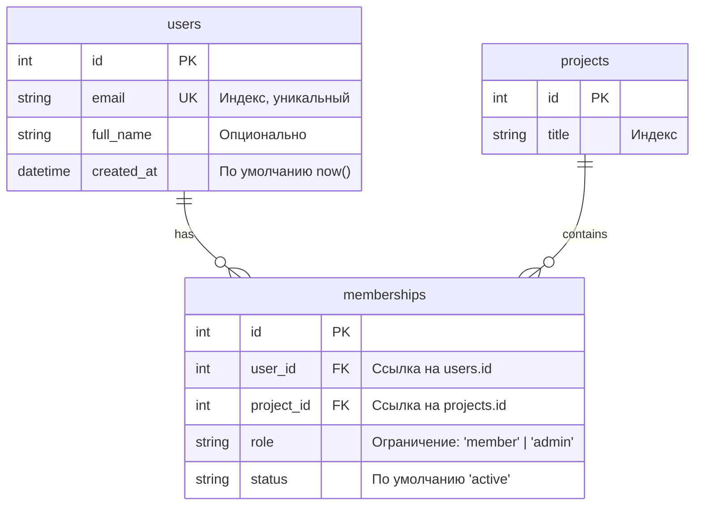

# FastAPI Alembic Project

Практический REST API сервис для управления пользователями, проектами и их участниками, построенный на современном стеке **FastAPI**, **SQLModel**, **Alembic** и **PostgreSQL**.

Проект демонстрирует реализацию связи «многие-ко-многим» (Many-to-Many) с дополнительными атрибутами (`role`, `status`), декларативное управление схемой БД через Alembic, контейнеризацию базы данных в Docker и валидацию данных через Pydantic.

---

## Стек технологий

- **Язык**: Python 3.10+
- **Фреймворк**: [FastAPI](https://fastapi.tiangolo.com/) (с поддержкой `fastapi[standard]`)
- **ORM / База данных**: [SQLModel](https://sqlmodel.tiangolo.com/) (симбиоз SQLAlchemy и Pydantic)
- **Миграции**: [Alembic](https://alembic.sqlalchemy.org/)
- **СУБД**: PostgreSQL 16 (Alpine)
- **Конфигурация**: [pydantic-settings](https://docs.pydantic.dev/latest/concepts/pydantic_settings/)
- **Контейнеризация**: Docker & Docker Compose
- **ASGI-сервер**: Uvicorn

---

## Структура проекта

```text
fastapi_alembic_project/
├── alembic/                    # Конфигурация и скрипты миграций Alembic
│   ├── versions/               # Файлы ревизий миграций
│   ├── env.py                  # Окружение миграций (настройка подключения и метаданных)
│   └── script.py.mako          # Шаблон генерации новых миграций
├── app/
│   ├── core/
│   │   └── settings.py         # Настройки приложения через pydantic-settings
│   ├── db/
│   │   ├── engine.py           # Инициализация SQLAlchemy/SQLModel движка
│   │   └── session.py          # Генератор сессий БД (FastAPI Dependency)
│   ├── models/
│   │   ├── user.py             # Модель пользователя (User)
│   │   ├── project.py          # Модель проекта (Project)
│   │   └── membership.py       # Модель связи участников и проектов (Membership)
│   └── main.py                 # FastAPI приложение, DTO-схемы и эндпоинты
├── .env.example                # Пример переменных окружения
├── .gitignore                  # Исключения для Git
├── alembic.ini                 # Основной конфигурационный файл Alembic
├── docker-compose.yml          # Запуск контейнера PostgreSQL
└── requirements.txt            # Зависимости Python
```

---

## Модели данных и схема БД

Проект реализует реляционную схему для совместной работы над проектами:



### Особенности схемы:
1. **Уникальность членства**: `UniqueConstraint("user_id", "project_id")` гарантирует, что пользователь не может быть добавлен в один и тот же проект повторно.
2. **Проверка роли (Check Constraint)**: `CheckConstraint("role IN ('member', 'admin')", name="ck_memberships_role")` защищает целостность данных на уровне СУБД.
3. **Целостность и аудит**: автоматическая фиксация времени регистрации пользователя (`server_default="now()"`).

---

## Быстрый старт

### 1. Клонирование репозитория

```bash
git clone https://github.com/Vegas30/fastapi_alembic_project.git
cd fastapi_alembic_project
```

### 2. Настройка виртуального окружения

```bash
# Создание виртуального окружения
python -m venv .venv

# Активация окружения (Windows PowerShell)
.venv\Scripts\Activate.ps1

# Активация окружения (Linux/macOS)
source .venv/bin/activate

# Установка зависимостей
pip install -r requirements.txt
```

### 3. Настройка переменных окружения

Скопируйте пример файла конфигурации:

```bash
cp .env.example .env
```

Параметры по умолчанию в `.env`:
```ini
POSTGRES_HOST=localhost
POSTGRES_PORT=5433
POSTGRES_DB=alembic_practic_bd
POSTGRES_USER=postgres
POSTGRES_PASSWORD=postgres
```

### 4. Запуск базы данных в Docker

```bash
docker compose up -d
```
> Контейнер PostgreSQL запустится на порту `5433` (чтобы не конфликтовать со стандартным локальным инстансом на `5432`).

### 5. Применение миграций

```bash
# Применение существующих миграций до актуальной версии
alembic upgrade head
```

### 6. Запуск сервера разработки

```bash
uvicorn app.main:app --reload
```

После запуска сервис доступен по адресу: [http://localhost:8000](http://localhost:8000).

---

## Документация API

Интерактивная документация Swagger UI и ReDoc генерируются автоматически:
- **Swagger UI**: [http://localhost:8000/docs](http://localhost:8000/docs)
- **ReDoc**: [http://localhost:8000/redoc](http://localhost:8000/redoc)

### Эндпоинты

| Метод | Путь | Описание | Код ответа |
|---|---|---|---|
| `POST` | `/users` | Создание нового пользователя | `201 Created` / `409 Conflict` |
| `POST` | `/projects` | Создание нового проекта | `201 Created` |
| `POST` | `/projects/{project_id}/join` | Добавление пользователя в проект | `201 Created` / `400` / `404` / `409` |
| `GET` | `/projects/{project_id}/members` | Получение списка участников проекта | `200 OK` / `404 Not Found` |

---

## Примеры запросов

### 1. Создание пользователя
```bash
curl -X POST "http://localhost:8000/users" \
  -H "Content-Type: application/json" \
  -d '{"email": "alex@example.com", "full_name": "Alex Mercer"}'
```

Ответ:
```json
{
  "id": 1,
  "email": "alex@example.com",
  "full_name": "Alex Mercer"
}
```

### 2. Создание проекта
```bash
curl -X POST "http://localhost:8000/projects" \
  -H "Content-Type: application/json" \
  -d '{"title": "Разработка микросервиса"}'
```

Ответ:
```json
{
  "id": 1,
  "title": "Разработка микросервиса"
}
```

### 3. Добавление пользователя в проект
```bash
curl -X POST "http://localhost:8000/projects/1/join" \
  -H "Content-Type: application/json" \
  -d '{"user_id": 1, "role": "admin"}'
```

Ответ:
```json
{
  "id": 1,
  "user_id": 1,
  "project_id": 1,
  "role": "admin",
  "status": "active",
  "email": "alex@example.com"
}
```

### 4. Получение списка участников проекта
```bash
curl -X GET "http://localhost:8000/projects/1/members"
```

Ответ:
```json
[
  {
    "id": 1,
    "user_id": 1,
    "project_id": 1,
    "role": "admin",
    "status": "active",
    "email": "alex@example.com"
  }
]
```

---

## Шпаргалка по командам Alembic

- **Создание новой автомиграции**:
  ```bash
  alembic revision --autogenerate -m "описание изменений"
  ```
- **Применение всех миграций**:
  ```bash
  alembic upgrade head
  ```
- **Откат на одну ревизию назад**:
  ```bash
  alembic downgrade -1
  ```
- **Просмотр истории миграций**:
  ```bash
  alembic history --verbose
  ```

---

## Лицензия

Проект распространяется для учебных и практических целей под лицензией MIT.
